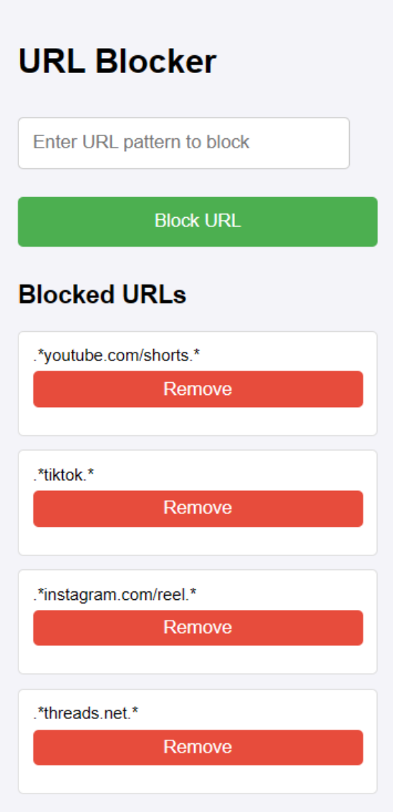

# Block Unwanted Content: Reclaim Your Time and Freedom

Are you tired of wasting countless hours on mindless, addictive content like YouTube Shorts, TikTok, Instagram Reels, and X.com? Do you feel the frustration of losing precious time to platforms designed to keep you hooked, draining your productivity and imprisoning your mind? This Chrome extension is here to help you break free from the clutches of big tech corporations and their time-sucking algorithms.

## Purpose

This Chrome extension is designed to block unwanted content that distracts you and saps your valuable time while ensuring your privacy and data are respected. **We do not collect any personal data or browsing history.**

**No data is collected in any form!**

By making this project open source, we offer users complete transparency. You can verify the truth of our claims by simply checking the source code.

**Transparency and data privacy are our top priorities.**


 By blocking sites like YouTube Shorts, TikTok, Instagram Reels, and X.com, you can take back control of your browsing experience and focus on what truly matters. These platforms are notorious for creating addictive environments, capturing your attention, and turning minutes into hours without you even realizing it. They are designed to maximize engagement at the cost of your life and mental well-being.

Join us in the fight against the mental prisons created by big tech corporations.

## How to Use

### Blocking a URL

1. **Enter the URL Pattern:**
   - In the text box labeled "Enter URL pattern to block", type the URL pattern that you want to block. For example, to block all pages from a specific website, you can use patterns like `.*youtube.com/shorts.*` or `.*tiktok.*`.

2. **Click "Block URL":**
   - After entering the URL pattern, click the green "Block URL" button. This will add the URL pattern to the list of blocked URLs.

### Managing Blocked URLs

- **Blocked URLs List:**
  - Below the "Block URL" button, you will see a list of all the blocked URLs. Each URL pattern that you have blocked will appear here.

- **Removing a URL:**
  - To remove a URL from the blocked list, click the red "Remove" button next to the URL pattern you want to unblock. This will remove the URL from the list and it will no longer be blocked.

### Default Blocked URLs

Here are some examples of how to use define a URL you might want block. Some of those are well know to steal our time more then we would want, so you can copy and paste from those example below if you want.
 
- `.*youtube.com/shorts.*`
- `.*tiktok.*`
- `.*instagram.com/reel.*`
- `.*threads.net.*`
- `.*x.com.*`



These default URLs can be enabled or disabled as needed, but cannot be removed from the list. To enable or disable these default blocked URLs, use the toggle button in the extension settings.

## Understanding `.*` in Regular Expressions

When using this extension to block URLs, you'll often see the pattern `.*` used in URL patterns. This is a regular expression (regex) syntax that is very powerful for matching a wide range of text. Here’s what it means:

- **`.` (Dot):** The dot character matches any single character except newline characters. It acts as a wildcard.
- **`*` (Asterisk):** The asterisk character is a quantifier that matches zero or more of the preceding element. In this case, it matches zero or more of any character (because it follows the dot).

### Combining `.` and `*`

When you put them together as `.*`, it means "match any sequence of characters, including none."

### Examples

Here are some examples of how `.*` can be used in URL patterns:

- **`.*youtube.com/shorts.*`**
  - **Meaning:** Match any URL that contains "youtube.com/shorts" anywhere in the URL.
  - **Example URLs Matched:**
    - `https://www.youtube.com/shorts/abcd1234`
    - `http://youtube.com/shorts/some-video`
    - `https://subdomain.youtube.com/shorts/another-video`

- **`.*tiktok.*`**
  - **Meaning:** Match any URL that contains "tiktok" anywhere in the URL.
  - **Example URLs Matched:**
    - `https://www.tiktok.com`
    - `http://m.tiktok.com`
    - `https://tiktok.com/user/someuser`

- **`.*instagram.com/reel.*`**
  - **Meaning:** Match any URL that contains "instagram.com/reel" anywhere in the URL.
  - **Example URLs Matched:**
    - `https://www.instagram.com/reel/abcd1234`
    - `http://instagram.com/reel/some-video`

- **`.*threads.net.*`**
  - **Meaning:** Match any URL that contains "threads.net" anywhere in the URL.
  - **Example URLs Matched:**
    - `https://www.threads.net/some-thread`
    - `http://threads.net/user/someuser`

### Why Use `.*`?

Using `.*` makes your URL blocking pattern very flexible and powerful. It ensures that any variation of the URL that contains the specified string will be matched and blocked. This is useful for sites that might use different subdomains or URL structures.

By understanding and using `.*`, you can effectively block a wide range of URLs with a single pattern.

### Notes

- **URL Pattern Format:**
  - The URL patterns use regular expressions. Make sure to use the correct format to match the URLs you want to block.

- **Refresh the Page:**
  - After blocking or unblocking a URL, you may need to refresh any open tabs for the changes to take effect.

## Features

- **Default Blocked URLs:** Out of the box, this extension blocks time-wasting platforms like YouTube Shorts, TikTok, Instagram Reels, and X.com. These defaults can be toggled on and off as needed.
- **Custom URL Blocking:** Users can add or remove their own list of blocked URLs to tailor the extension to their specific needs.
- **Simple User Interface:** An easy-to-use popup interface allows you to manage blocked URLs and toggle default settings with a single click.
- **Side panel:** the popup has an **"Abrir no painel lateral"** button that opens the same screen in Chrome's Side Panel — the area on the right edge of the window — so the controls stay open while you browse.
- **Non-Removable Defaults:** Critical distractions are always kept at bay, but can be toggled if absolutely necessary.
- **Age filter on youtube.com:** Recommendation cards older than the selected limit are hidden (3 days by default; configurable from 1 to 365 days) — home, subscriptions, search results, channels and the sidebar. Shorts, history, liked videos, watch later, playlists and the player are never filtered.
- **Games and ads off the feed:** The playables shelf cards and the sponsored cards (in-feed, search and sidebar slots) are hidden too — they carry no age, so they go whole. Both filters are toggled in the popup, on by default.
- **Keyword and channel blocking:** One toggle hides any video whose title carries one of the keywords (shipped with the known AI terms — ChatGPT, Claude, Gemini, OpenAI, IA, AI and friends, in pt and en) or whose channel is on the channel list. Both lists are editable in the popup as badges with an "×" to remove and Enter to add; matching ignores accents, case and punctuation. The hiding mechanism is the same as the age filter's.
- **Block button on YouTube:** a small chip next to the channel name — on the video owner, the channel header and video cards on hover — adds or removes that channel from the block list without opening the popup.
- **Always-recommended channels (allowlist):** Pick subscribed channels that must never be filtered — not by keyword, not by age, not even if the channel is also blocked. The subscriptions catalog is collected from `youtube.com/feed/channels` and stored locally; the popup searches it by name as you type, and selected channels become badges with photo and name. Adding or removing takes effect immediately in open tabs.

### How You Can Help

- **Contribute Code:** Add new features, improve existing ones, or help with bug fixes.
- **Submit Ideas:** Share your thoughts on how we can make this extension more effective.
- **Spread the Word:** Let others know about this project so they can also benefit from it.
- **Collaborate:** Work with other developers to create a stronger, more resilient tool against digital distraction.

Let’s build a community-driven solution to break free from the grasp of big tech corporations.

## Filtro de idade nas recomendações

Um content script em `youtube.com` esconde o card de **recomendação** que passa da idade máxima
configurada no popup (3 dias por padrão; de 1 a 365 dias).
A idade é a que o próprio YouTube escreve no card — "há 5 dias", "há 2 sem.", "1 week ago" —, então
o filtro lê o texto renderizado, não uma data absoluta: o que vale é a mesma conta que o usuário vê.
O limite é estrito: o card exatamente no limite fica; o mais velho some.

Vale onde há recomendação: home, inscrições, resultados de busca, página de canal e a coluna lateral
do player. Fica fora do que o usuário escolheu ver: histórico, vídeos curtidos, assistir depois,
biblioteca, playlists e a página do vídeo principal — ali a data costuma ser uma **ação** ("Assistido
há 2 dias") e esconder o item apagaria a própria lista aberta. **Shorts não são tocados**: o
bloqueio de URL que já existia continua sendo o dono desse caminho. Card sem data reconhecível, Mix
(link de playlist), canal, post e transmissão ao vivo ficam visíveis — o filtro falha **aberto**,
nunca esconde o que não entendeu.

**Jogos e anúncios** não têm idade no card: o jogo da prateleira de playables mostra "Jogado 345 mil
vezes" e "Novidade", o anúncio mostra "Patrocinado". Por isso eles têm interruptor próprio e somem
**inteiros**, sem olhar data — o card de playables (`/playables/`) e o anúncio no feed, na busca e
no slot da coluna lateral. São cards de recomendação como os outros; o que os distingue é não haver
publicação para julgar. A **prateleira** que ficar sem nenhum card visível também some, para o
título não ficar solto sobre um vazio — mas só a que teve todos os cards escondidos pelo filtro; a
de Shorts, que nunca é tocada, continua de pé.

O popup tem três preferências: **"Ocultar vídeos antigos"**, a idade máxima em dias e
**"Ocultar jogos e anúncios"**. Os dois interruptores ficam ligados por padrão; a idade começa em
3 dias. A página reage na hora: desligar um filtro devolve o que estava escondido sem recarregar, e
os filtros são independentes. Nada é apagado ou guardado: o filtro só
aplica `display: none` com uma marca no card, nunca remove nó, nunca fala com a rede e não guarda
nada sobre os vídeos. Como o YouTube é uma SPA, a varredura acompanha nó novo, a navegação
(`yt-navigate-finish`) e uma varredura periódica de 2 s, com piso de 500 ms entre uma e outra.

## Palavras-chave e canais bloqueados

O interruptor **"Bloquear por palavras-chave e canais"** esconde o card de recomendação cujo
**título** tem uma das palavras-chave da lista ou cujo **canal** está na lista de canais. A lista de
palavras-chave já vem de fábrica com os termos conhecidos de IA, em pt e en — "ChatGPT",
"Claude", "Gemini", "OpenAI", "GPT-4", "IA", "AI", "inteligência artificial", "machine learning" e
mais — gravada na primeira leitura como uma lista comum, editável: no popup, cada item é uma
**badge** com um "×" que o remove; digitar e apertar **Enter** (ou o botão) adiciona. Os campos de
palavra-chave e de canal ficam juntos, no topo da seção, antes das listas: o botão de adicionar canal
não fica enterrado embaixo de dezenas de badges. A comparação ignora acento, maiúscula e pontuação —
"GPT-4" e "gpt 4" são a mesma palavra — e casa por palavra inteira: "ia" não esconde "pianista". Para
canais basta conter o nome digitado.

A ocultação é exatamente a da idade: `display: none` com a mesma marca no card, prateleira
vazia recolhida, desligar o interruptor devolve tudo sem recarregar, e o mesmo escopo — home,
inscrições, busca, canal e coluna lateral; Shorts, histórico e listas salvas ficam de fora. As listas
(`blockedKeywords` e `blockedChannels`) moram em `chrome.storage.sync`, cabem 100 itens de até 60
caracteres cada, e o interruptor (`blockKeywords`) vem desligado: é o usuário quem ativa.

## Botão ao lado do nome do canal

No YouTube, o nome do canal ganha um chip discreto: no dono do vídeo, no cabeçalho do canal e nos
cards de vídeo (aí só com o card sob o mouse; em telas de toque, sempre). O chip mostra
**Bloquear** e, quando o canal já está na lista, **Desbloquear**. Nos cards ele vira só o ícone de
bloqueio, para não disputar espaço com o título.

O botão não cria um segundo estado: ele lê e escreve a mesma lista `blockedChannels` do popup, pelo
service worker. Por isso as duas telas ficam sincronizadas nos dois sentidos, inclusive quando o
canal é editado nas configurações. Canais da **allowlist** não recebem o botão — eles nunca são
filtrados, então oferecer o bloqueio ali seria uma promessa falsa. O interruptor **"Bloquear por
palavras-chave e canais"** continua sendo quem decide se os cards somem: o chip só mexe na lista,
como o campo do popup.

## Sempre recomendados (allowlist)

A seção **Sempre recomendados** do popup define canais que **nunca** são filtrados — a allowlist vence
a idade, a palavra-chave e até um canal que esteja nas duas listas. A lista é feita a partir das suas
**inscrições**: ao visitar `youtube.com/feed/channels`, o content script lê os cards
`ytd-channel-renderer` (nome, handle e foto) e manda para o service worker, que **mescla** o que já
estava guardado em `chrome.storage.local` (rolar a página acumula a lista inteira). No popup, digitar
o nome busca nesse catálogo e mostra sugestões com foto; escolher uma cria a badge com foto e nome, e o
"×" remove. A allowlist em si (`allowedChannels`, no `sync`) guarda só nome e handle — a foto é
resolvida do catálogo local na hora de renderizar, o que mantém o `sync` dentro da cota.

O catálogo nunca sai da máquina: nenhuma chamada de rede, nenhuma API do YouTube — só o DOM da página
de inscrições quando o usuário a visita. Sem catálogo ainda, o popup mostra o atalho para abrir a
página. As mudanças valem na hora, com o mesmo rescan das outras listas.

### Instância órfã

Recarregar a extensão invalida o contexto dos content scripts já injetados, mas **não mata** os timers
deles: a instância velha continua no DOM. Sem cuidado, ela e a instância nova (reinjetada) brigam —
uma esconde, a outra mostra — e os cards ficam piscando. Por isso o filtro confere
`chrome.runtime.id` na varredura periódica e no agendamento: perdido o contexto, ele para o timer e
desconecta o `MutationObserver` sozinho, sem tocar mais no DOM. Ao atualizar a partir de uma versão
anterior à 2.3.1, a aba do YouTube que já estava aberta ainda roda a instância antiga até um refresh —
é a única migração que pede recarga; das próximas vezes a instância velha se desliga sozinha.

## Painel lateral do Chrome

O botão **"Abrir no painel lateral"**, no topo do popup, abre esta mesma interface no **Side Panel**
do Chrome — a área que fica à direita da janela, ao lado da página. É o mesmo documento
(`popup.html`), carregado dentro de um iframe que só ajusta a largura: as preferências, as listas e o
service worker são os mesmos, então não existem duas cópias da tela. O painel também aparece no menu
de painéis laterais do navegador, porque o manifesto declara `side_panel`. Abrir a partir do popup
precisa de Chrome 116 ou mais novo; em versões anteriores o botão fica oculto e o popup continua
funcionando normalmente.

## Estrutura

```
manifest.json
src/
├── background/            service worker (módulos ES)
│   ├── service-worker.js  ponto de entrada: instalação e mensagens
│   ├── blocking.js        bloqueio de URLs (declarativeNetRequest)
│   ├── channels.js        catálogo local dos canais inscritos (chrome.storage.local)
│   ├── injection.js       re-injeta o filtro nas abas do YouTube abertas (chrome.scripting)
│   └── settings.js        preferências e limite de idade do filtro
├── shared/
│   └── settings-contract.js  padrões, limites, chaves e normalização (script clássico, sem DOM)
├── content/
│   ├── block-guard.js     redireciona URLs bloqueadas (script clássico)
│   ├── age-core.js        lê a idade do card (o limite vem do contrato; script clássico, sem DOM)
│   ├── keyword-core.js    casa palavras-chave e canais no texto do card (script clássico, sem DOM)
│   ├── channel-rules.js   normaliza listas e resolve allowlist/blocklist (script clássico, sem DOM)
│   ├── youtube-dom.js     lê card, alvo do chip e card de inscrição (script clássico)
│   ├── content-runtime.js ciclo da página: observer, navegação, visibilidade, varredura e guarda de órfão
│   ├── content-settings.js leitura única das preferências e um listener para os adaptadores
│   ├── channel-catalog.js  coleta as inscrições da página de canais para o catálogo local
│   ├── channel-button.js  chip de bloqueio ao lado do nome do canal
│   └── age-filter.js      esconde/mostra os cards no site do YouTube
├── popup/                 interface: bloqueio e configurações do filtro
└── sidepanel/             abre o popup dentro do painel lateral do Chrome
```

Nenhum módulo fala com a rede: a extensão não tem servidor, não tem token e não tem
configuração de fora. O que ela sabe mora no `chrome.storage` do próprio perfil.

## Configuração

A seção **Filtro do YouTube** do popup tem duas caixas ligadas por padrão: **"Ocultar vídeos antigos"**
(`hideOldVideos`) e **"Ocultar jogos e anúncios"** (`hideGamesAndAds`), além do limite **Idade máxima**
(`maxAgeDays`, de 1 a 365 dias, padrão 3). A seção **Palavras-chave e canais** traz o interruptor
`blockKeywords` (desligado por padrão) e as listas `blockedKeywords`/`blockedChannels`; a seção
**Sempre recomendados** guarda `allowedChannels` (nome + handle) e o catálogo de inscrições vive em
`chrome.storage.local`. As preferências
moram em `chrome.storage.sync` e um único feed no content script
(`content-settings.js`) entrega as mudanças ao filtro e ao chip — por isso os filtros reagem sem
recarregar a página. A aba do YouTube que
já estava aberta quando a extensão foi recarregada também não precisa de refresh: o service worker
re-injeta o filtro nela (`chrome.scripting`) no `onInstalled`/`onStartup` **e a cada salvamento do
popup**, porque recarregar a extensão órfã os content scripts antigos. Assim, ativar o interruptor
ou editar as badges vale na hora em todas as abas abertas.

## Permissões

Quatro: `storage` (as listas e as preferências), `declarativeNetRequest` (o bloqueio de URLs),
`scripting` (re-injetar o filtro nas abas do YouTube abertas quando a extensão é recarregada) e
`sidePanel` (abrir a interface no painel lateral à direita). A entrada `host_permissions` de
`youtube.com` acompanha os content scripts do filtro e continua limitando onde a injeção pode
acontecer. As
permissões `webRequest`, `webNavigation`, `activeTab`, `declarativeNetRequestFeedback`
e `alarms` que versões anteriores declaravam **não existem mais** — a coleta e o servidor local
que precisavam delas saíram na 2.0.0.

## Testes

```powershell
npm test
```

O **manifesto** tem a primeira suíte (`test/manifest.test.mjs`): os limites do Chrome nos campos de
texto — a `description` tem teto de **132** caracteres e um a mais faz o navegador recusar o pacote
inteiro, sem aviso na página —, a versão igual à do `package.json` e todo arquivo apontado pelo
manifesto existindo. Foi assim que a 1.10.0 passou a não filtrar nada em silêncio.

A **idade dos cards** tem suíte própria (`test/age-core.test.mjs`): as formas que o YouTube escreve
em pt e en — "há 5 h", "há 2 sem.", "há 1 mês", "há 13 anos", "1 day ago" —, a recusa das datas de
ação ("Assistido há 5 dias" não é publicação), o que não é data ("N mil assistindo"), e o limite
**estrito** de 3 dias: "há 3 dias" fica, "há 4 dias" some. O `age-core.js` não conhece DOM nem
`chrome`, por isso roda num contexto `vm` do Node.

O **casamento de palavras-chave e canais** tem a sua (`test/keyword-core.test.mjs`): a normalização
(acentos, maiúsculas, pontuação, zero-width), a comparação por palavra inteira nos títulos e a de
conter nos nomes de canal. O `keyword-core.js` também é puro e roda em `vm`.

As **listas de canais** têm uma suíte só delas (`test/channel-rules.test.mjs`), e os adaptadores
(content scripts, popup e settings) usam a mesma regra: normalização, identidade por handle ou nome,
allowlist/blocklist e o próximo estado ao clicar no chip.

O **DOM do YouTube** tem uma leitura só (`youtube-dom.js`) e uma suíte com fixtures
(`test/youtube-dom.test.mjs`): card clássico, lockup, anúncio, Shorts e página de canal. O filtro
classifica o modelo lido e o chip se posiciona a partir dele; uma mudança de layout é ensinada uma
vez. As fixtures rodam em `vm`, com um seletor mínimo que cobre as formas usadas no layout.

As **configurações** têm um contrato único (`test/settings-contract.test.mjs`): padrões, chaves,
limites (idade de 1 a 365 dias, listas de 100 itens com 60 caracteres, allowlist de 50 canais) e
normalização. O popup monta os controles a partir dele e o service worker continua sendo a
autoridade que valida e grava em `chrome.storage.sync`.

O **feed dos content scripts** tem suíte própria (`test/content-settings.test.mjs`): uma leitura do
storage, um listener e a ordem que faz uma mudança vencer uma leitura inicial atrasada. O filtro e o
chip assinam esse feed em vez de cada um montar o próprio `chrome.storage`.

O **catálogo de inscrições** tem duas suítes: `test/channels.test.mjs` fixa a identidade (um canal
com handle e outro sem viram uma linha só, pelo `channel-rules.js`) e o teto de 60 caracteres que a
allowlist aceita; `test/channel-catalog.test.mjs` cobre a coleta na página de inscrições, a recusa
de varrer outras páginas e a reinjeção. O `channels.js` importa as regras puras para o service
worker, do mesmo jeito que o `settings.js`.

O **botão ao lado do nome do canal** tem suíte própria (`test/channel-button.test.mjs`): o chip
aparece no dono do vídeo, o clique adiciona e remove `blockedChannels` pelo service worker, a
allowlist tira o botão e o layout novo do lockup recebe a versão compacta. O DOM falso roda em `vm`.

O **ciclo da página** é um só (`content-runtime.js`) e tem suíte própria
(`test/content-runtime.test.mjs`): um observer e um sweep para vários adaptadores, aba oculta e
desligamento da instância órfã. O filtro de idade, o chip e o catálogo registram apenas o próprio
`scan`; as suítes dos adaptadores cobrem a instância órfã e a aba oculta no chip.

## Installation

1. Clone the repository.
2. Open Chrome and navigate to `chrome://extensions/`.
3. Enable "Developer mode" at the top right corner.
4. Click "Load unpacked" and select the cloned directory.

## Contribution Guidelines

We welcome contributions from everyone. Please check out our [contribution guidelines](CONTRIBUTING.md) for more details on how to get started.

## License

This project is licensed under the MIT License - see the [LICENSE](LICENSE) file for details.

---
